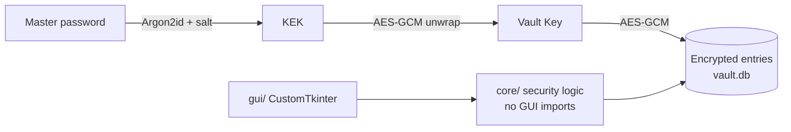
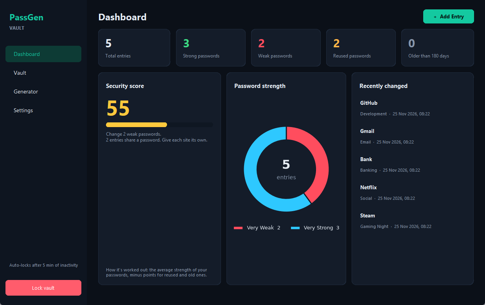
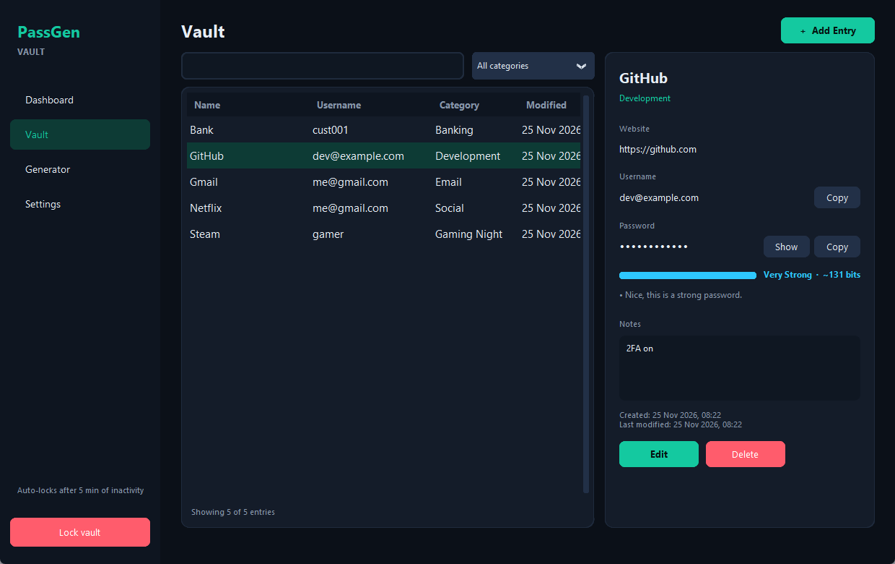
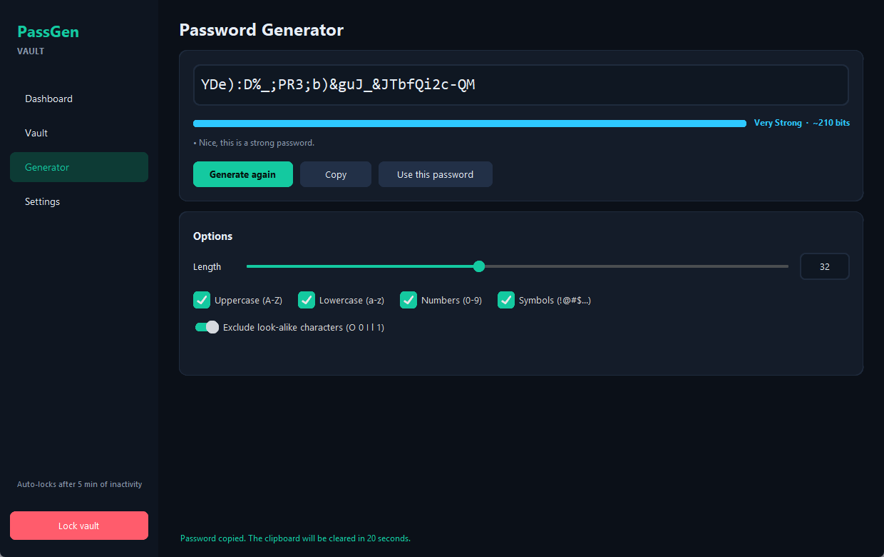
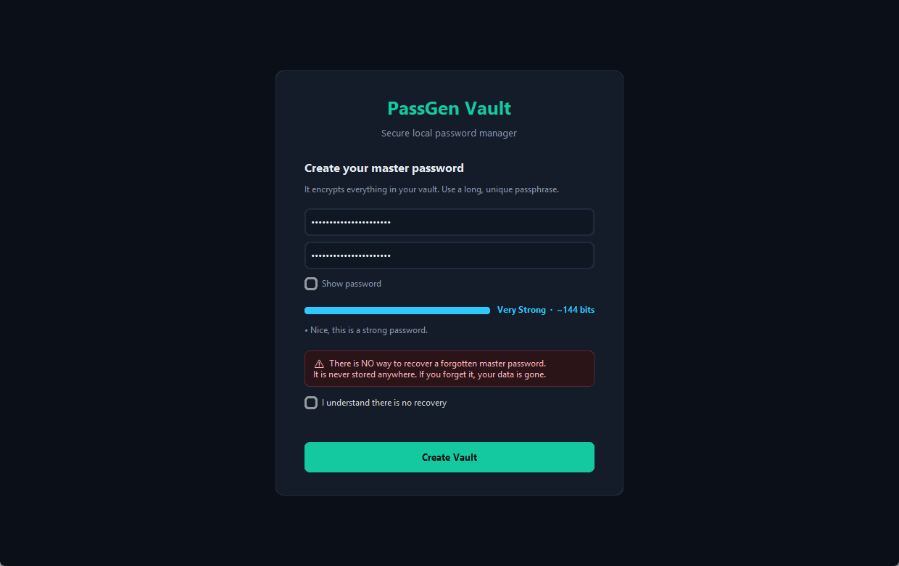

# PassGen Vault

A secure, local password manager for Windows, written in Python. It stores your passwords in an encrypted file on your own computer. There's no cloud and no account, and nothing is sent over the network.

I built it as a B.Tech CSE (Cybersecurity) project to learn how real password managers handle keys and encryption, and to be able to explain every security decision.

## Problem statement

Most people reuse a few weak passwords because remembering dozens of strong ones is hard. Writing them in a notes file or a spreadsheet is not safe either: anyone who gets the file can read them. A password manager fixes this, but it is only as good as its cryptography. This project is a small, readable password manager that uses the same building blocks as professional ones (a memory-hard KDF, envelope encryption and authenticated encryption) and documents its limits honestly.

## Objectives

- Store credentials so that a stolen vault file is useless without the master password.
- Never store the master password, or any hash of it.
- Help the user pick strong passwords with a generator and an offline strength checker.
- Show the overall health of the vault on a dashboard (weak, reused and old passwords).
- Keep all security code separate from the GUI so it can be tested automatically.

## Features

**Security**
- Argon2id key derivation (64 MiB, t=3, p=4) and AES-256-GCM encryption
- Envelope encryption: a random Vault Key is wrapped by a key made from the master password
- Logging in = unwrapping the Vault Key. No password hash is stored
- All entry fields encrypted as one blob, with a fresh nonce on every save and AAD tied to the row
- Progressive lockout: after 3 wrong tries you wait 30 s, then 60 s, 120 s ... up to 15 min. It survives restarts
- Auto-lock after inactivity (default 5 min)
- Clipboard auto-clear (default 20 s), only if the clipboard still holds what the app copied
- Encrypted backup and restore. Restore checks the backup's password first and keeps the old vault
- Change master password (re-wraps the key, doesn't need to re-encrypt entries)
- Event logging that never includes secrets (checked by a test)

**Everyday use**
- Add, view, edit, delete (with confirmation) and live search across name, URL, username, category and notes
- Category filter with preset and custom categories
- Password masked by default, with Show/Hide and Copy buttons
- Password generator: 8–64 characters, choose character types, exclude look-alike characters (O 0 I l 1)
- Offline strength checker with 5 levels and tips (common passwords, sequences, repeats, keyboard walks, dates, username or site name inside the password)
- Dashboard: totals, strong/weak counts, reused and old passwords, recent entries, a 0–100 security score and a donut chart

## Tech stack

| Part | Choice |
|---|---|
| Language | Python 3.11+ |
| GUI | CustomTkinter, Matplotlib (chart) |
| Crypto | `cryptography` (AES-GCM), `argon2-cffi` (Argon2id) |
| Storage | SQLite (`sqlite3`, parameterized queries only) |
| Randomness | `secrets` and `os.urandom` |
| Paths | `platformdirs` |
| Tests | pytest |

## Architecture



More diagrams (module map, unlock flow, database schema) are in [docs/architecture.md](docs/architecture.md).

```
PassGen-Vault/
├── main.py                 # starts the app
├── core/                   # all security logic, no GUI imports
│   ├── config.py           # paths, defaults, Argon2id settings
│   ├── crypto.py           # KDF, key wrap/unwrap, entry encryption
│   ├── auth.py             # setup, unlock, lockout, change password
│   ├── database.py         # SQLite schema and queries
│   ├── vault_manager.py    # add/edit/delete/search, dashboard stats
│   ├── generator.py        # password generator
│   ├── strength.py         # strength checker
│   ├── clipboard.py        # copy + auto-clear logic
│   ├── backup.py           # export / verify / restore
│   ├── settings.py         # auto-lock and clipboard timer settings
│   └── logging_setup.py
├── gui/                    # CustomTkinter screens
├── assets/common_passwords.txt
├── docs/                   # architecture + demo script
└── tests/                  # pytest tests
```

## Installation (Windows)

You need Python 3.11 or newer. Open PowerShell in the project folder:

```powershell
python -m venv .venv
```

```powershell
.\.venv\Scripts\Activate.ps1
```

```powershell
pip install -r requirements.txt
```

If PowerShell blocks the activate script, run `Set-ExecutionPolicy -Scope CurrentUser RemoteSigned` once.

## How to run

```powershell
python main.py
```

On first run you create a master password. The vault is saved at `%APPDATA%\PassGenVault\vault.db`.

To try the app without touching your real vault, point it at another folder first:

```powershell
$env:PASSGEN_DATA_DIR = "$env:TEMP\passgen-demo"; python main.py
```

## How to run the tests

```powershell
python -m pytest -v
```

The tests use temporary folders and never touch the real vault. They cover:
- encryption round trips and tamper detection
- unique nonces
- wrong and right passwords, including after reopening the database
- lockout timing and persistence
- no plaintext in the raw database file
- SQL injection strings
- changing the master password
- backup and restore
- the generator and the strength checker
- clipboard auto-clear
- no secrets in the logs

## Screenshots

All screenshots use fake demo data.

| Dashboard | Vault |
|---|---|
|  |  |

| Generator | First-run setup |
|---|---|
|  |  |

To add or replace screenshots:
1. Run the app with a demo data folder (see "How to run") and add a few fake entries.
2. Press `Win + Shift + S` and capture the window.
3. Save the image in `docs/screenshots/` and link it in the table above.

Never put real passwords, or file paths that show your username, in screenshots.

## Security summary

- A stolen vault file can't be read without the master password, and each guess costs one Argon2id run.
- The master password is never saved. Forgetting it means losing the data, with no recovery.
- It does **not** protect against malware or keyloggers on your PC, or someone using it while it is unlocked.
- The in-app lockout can be bypassed by copying the file, so the real protection is a strong master password.

Full threat model and limitations: **[SECURITY.md](SECURITY.md)**.

## Future enhancements

- Passphrase mode in the generator (random words, e.g. from the EFF word list)
- Have I Been Pwned breach check using k-anonymity (only the first 5 characters of the SHA-1 hash are sent)
- TOTP (2FA code) support
- Browser extension for autofill
- Package as a single `.exe` with PyInstaller
- Hide copied passwords from Windows Clipboard History

## Credits

- Common password list: see [assets/README.md](assets/README.md).
