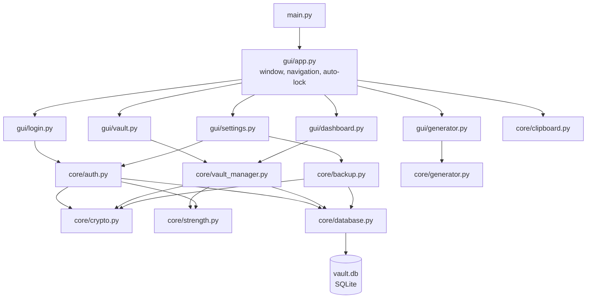
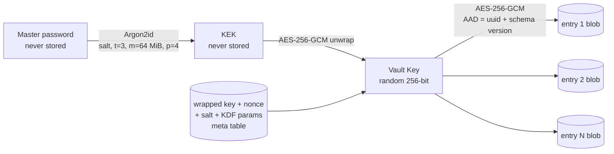
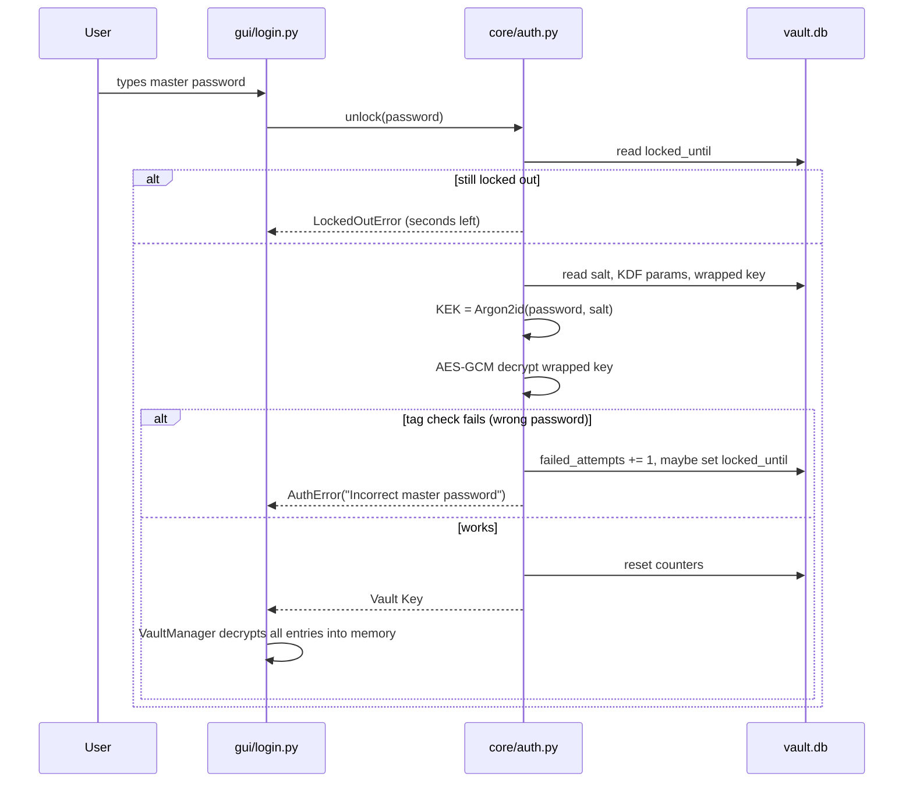

# Architecture

PassGen Vault has two layers:

- **`core/`** holds all the security logic: crypto, login, storage, the vault, the generator, the strength checker, the clipboard timer and backups. It never imports a GUI library, so all of it can be tested with pytest without opening a window.
- **`gui/`** is the CustomTkinter interface. It only calls functions in `core/` and never touches keys or SQL directly.

## Module map

## Key hierarchy

## Unlock flow

## Database schema

| Table | Column | Stored as | Notes |
|---|---|---|---|
| `meta` | `key`, `value` | plaintext | salt, KDF params, wrapped key + nonce, lockout counters, timer settings |
| `entries` | `id` | plaintext | row number |
| | `uuid` | plaintext | random UUID, part of the AAD |
| | `schema_version` | plaintext | layout version of the JSON, part of the AAD |
| | `nonce` | plaintext | 12 random bytes, new on every write |
| | `ciphertext` | encrypted | JSON of name, URL, username, password, category, notes, password_changed_at |
| | `created_at`, `updated_at` | plaintext | metadata leak (see SECURITY.md) |
